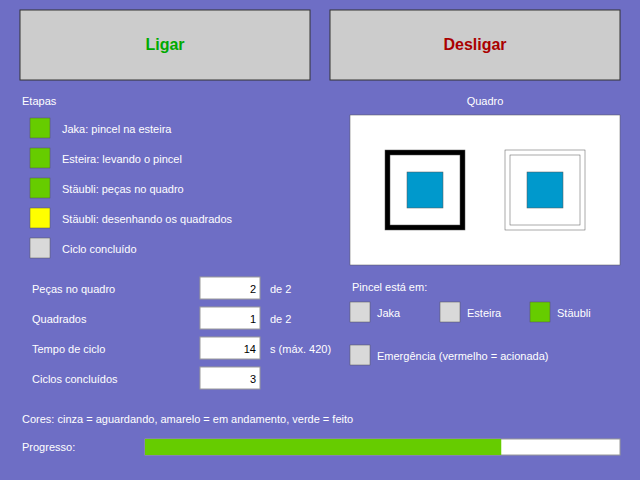

# PLC program

Automation Studio project: `plc/ProjetoFinalRobotica/ProjetoFinalRobotica.apj`
(Automation Studio 4.1.14, based on the course "ProjetoPadraoIHM" template).

## Where this project comes from

Compared file by file with the template the professor handed out
(`ProjetoFinalRobotica`, without the `plc/` copy's changes):

| | Professor's template | This project |
|---|---|---|
| Hardware (4PP481 + X20 modules, AR E3.10, IP `192.168.0.70`) | Yes | Same (only the panel's hardware description version differs, 1.1.0.0 vs 1.0.0.0) |
| Program | **None** (`Cpu.sw` has no task) | `NewProgram` with the sequence below |
| I/O mapping | Leftover entries for a program `Robos` that is not in the project, with an older wiring that does **not** match Table I | Matches Table I |
| HMI | B&R coffee-machine sample pages only | Adds `Init_Page` (start/stop buttons, 12-part progress) |
| Shared files | | 381 of the template's Logical files are identical |

So this project was built from the professor's template: it keeps the
template's hardware and libraries and adds the program, the I/O map and the
HMI page. It also contains `ProjetoPadrao.zip`, a snapshot from 29/05/2026
where `NewProgram` only had a conveyor test (`esteira1`, `esteira2`).

Starting from this project gives everything the template has plus a working
I/O map. If the template is used instead, its `IoMap.iom` must be cleaned
first, because the `Robos` entries point to a program that does not exist.

## Target configuration

| Item | Value | Where |
|---|---|---|
| CPU | 4PP481.1043-B5 | `Physical/Config1/Hardware.hw` |
| Automation Runtime | E3.10 (stored in the project, `AS/System/E0310`) | `Physical/Config1/4PP481_1043_B5/Cpu.pkg` |
| Ethernet IF5 | `192.168.0.70`, manual, no gateway, no DNS | `Hardware.hw` |
| Online connection | TCP/IP to `192.168.0.70`, port 11169 | `Cpu.pkg` |
| Task | `NewProgram`, Cyclic#1 (10 ms) | `Cpu.sw` |
| HMI | Visual Components object `Visu` (page `Init_Page`) | `Logical/Visualisation` |

> The handout says the Jaka robot is also at `192.168.0.70`. Two devices on the
> same network cannot share an IP, so one of the two values is wrong. Confirm
> on the cell.

## I/O mapping

All I/O variables are local to `NewProgram` and mapped in `IoMap.iom`. The
mapping matches Table I of the handout. Meanings are those of the whiteboard
application ([whiteboard-application.md](whiteboard-application.md)).

| Variable | Address | Meaning |
|---|---|---|
| `Jaka_DO7` | DI9371 ch 1 | DONE: marker on the conveyor |
| `Jaka_DO6` | DI9371 ch 2 | Spare |
| `Jaka_DO5` | DI9371 ch 3 | Pulse: marker gripped (used by the twin only) |
| `Staubli_DO4` | DI9371 ch 5 | DONE: both parts on the board |
| `Staubli_DO5` | DI9371 ch 6 | DONE: squares drawn, marker stored |
| `Staubli_DO6` | DI9371 ch 7 | Pulse: one part placed |
| `Staubli_DO7` | DI9371 ch 8 | Pulse: one square drawn |
| `Sensor_Staubli` | DI9371 ch 9 | Marker at the Stäubli end of the conveyor |
| `Sensor_Jaka` | DI9371 ch 10 | Marker at the Jaka end of the conveyor |
| `Emergencia` | DI9371 ch 12 | TRUE = safe |
| `Jaka_DI3` | DO9322 ch 1 | CMD: put the marker on the conveyor |
| `Jaka_DI2` | DO9322 ch 2 | Enable, TRUE while a cycle runs |
| `Jaka_DI1` | DO9322 ch 3 | Spare |
| `Staubli_DI12` | DO9322 ch 5 | CMD: place the two parts on the board |
| `Staubli_DI13` | DO9322 ch 6 | Enable, TRUE while a cycle runs |
| `Staubli_DI14` | DO9322 ch 7 | CMD: pick the marker and draw |
| `Staubli_DI15` | DO9322 ch 8 | Spare |
| `Esteira_StaubliJaka` | DO9322 ch 11 | Spare (always FALSE) |
| `Esteira_JakaStaubli` | DO9322 ch 12 | Carries the marker to the Stäubli |

## Sequence

Each robot task is a four-phase handshake: the PLC sets the command, the
robot sets DONE when it has finished, the PLC clears the command, the robot
clears DONE. There are no timers in the sequence.

| `Etapa` | Does | Next when |
|---|---|---|
| 0 | Idle. On start: reset flags and counters, set `Jaka_DI3` and `Staubli_DI12` | `Ligar AND Emergencia` |
| 1 | In parallel: `Jaka_DO7 AND Sensor_Jaka` → clear `Jaka_DI3`, start the conveyor. Conveyor `AND Sensor_Staubli` → stop it. `Staubli_DO4` → clear `Staubli_DI12` | Marker arrived, parts on the board, `Jaka_DO7` and `Staubli_DO4` cleared |
| 2 | Set `Staubli_DI14`; on `Staubli_DO5` clear it | `Staubli_DO5` |
| 3 | Count the cycle, clear `Ligar` | `Staubli_DO5` cleared → 0 |

- One run per start: `Ligar` is cleared at the end of the cycle, so the
  operator presses **Ligar** again for the next run (after putting the marker
  back at the Jaka and taking the parts off the board).
- Stop (**Desligar**) or E-stop: every command, enable and conveyor goes
  FALSE and `Etapa` returns to 0. E-stop also clears `Ligar`, so releasing it
  never restarts the cell by itself.
- `Staubli_DO6` / `Staubli_DO7` pulses advance the HMI counters. If the
  Stäubli program does not pulse them, the counters jump to 2 when the
  matching DONE arrives.
- `TwinSender;` stays the last line of `_CYCLIC`.

This replaces the previous sequence (below). Not compiled yet: the first
build happens on the lab PC.

## HMI (`Init_Page`)

*Preview drawn from the page file with sample values, not a screenshot of
the panel.*

| Element | Variable |
|---|---|
| Ligar / Desligar | `Ligar` (set to 1 / 0) |
| Step lamps: Jaka, conveyor, parts, drawing, cycle done | `iCorJaka`, `iCorEsteira`, `iCorPecas`, `iCorDesenho`, `iCorConcluido` |
| Parts on the board, squares, cycle time (s), completed cycles | `iPecasNoQuadro`, `iQuadrados`, `iTempoCiclo_s`, `iContador` |
| Whiteboard: parts and squares light up | `iCorPeca1/2`, `iCorQuadrado1/2` |
| Marker position: Jaka / conveyor / Stäubli | `iCorMarcJaka`, `iCorMarcEsteira`, `iCorMarcStaubli` (from `iMarcador`) |
| E-stop lamp | `iCorEmergencia` |
| Progress bar 0..4 | `iProgresso` (parts + squares) |

Lamp colors are palette indexes computed in the PLC, the same technique the
previous page used: grey 250 = waiting, yellow 46 = running, green 155 =
done, red 51 = E-stop. The page only uses control types that already existed
in the project (button, text, shape, bar graph) plus the numeric output of
the B&R sample. After the first build, adjust positions and fonts in the
Automation Studio page editor as needed; from then on edit the page there.

## Previous application (Renan's)

The project received from Renan built a 6-part pyramid:

- `Etapa` 0 → 1 → 2: the Jaka puts a part on the conveyor, the conveyor
  carries it, the Stäubli picks it and stacks it.
- `iContador` went up twice per part on purpose (odd: Jaka placed part n,
  even: Stäubli picked part n). The HMI showed a 6 × 2 table (Jaka/Stäubli
  per part) and a 3-2-1 pyramid lit by the even steps.
- Two problems it had, both solved by the new sequence: the 1 s pulse on
  `Staubli_DI12` stopped working after the first part (the timer input was
  never cleared), and the stop branch set `Staubli_DI12`, `Staubli_DI13` and
  `Jaka_DI3` to TRUE.

## Leftovers from the template

`Logical/Global.typ` still has the coffee machine types from the B&R sample
(`main_typ`, `brewing_typ`, ...), and `Logical/Visu` holds the sample pages.
They are not used by `NewProgram`.

## Files kept out of git

The repository is public, so some files stay out of git:

| Path | Why |
|---|---|
| `Temp/`, `Binaries/`, `Diagnosis/` | Regenerated by every Automation Studio build |
| `ProjetoPadrao.zip` | Original course template (56 MB), available on Teams |
| `*.set` | Per-user Automation Studio settings, named after classmates |
| `AS/` | B&R Automation Runtime E3.10 binaries (proprietary, 32 MB) |

The project is set to `StoreRuntimeInProject`, so a fresh clone is missing
`AS/System/E0310`. Before building on a new machine, copy `AS/` from the
original project on the lab PC, or install AR E3.10 in Automation Studio
(lab PCs that already build the cell projects should have it).
